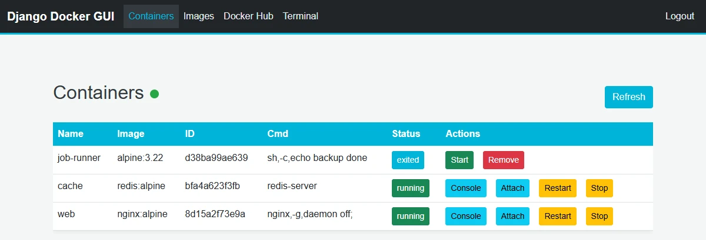
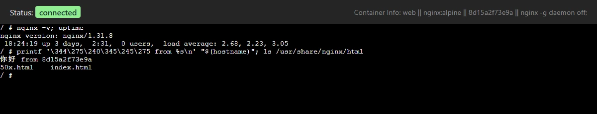
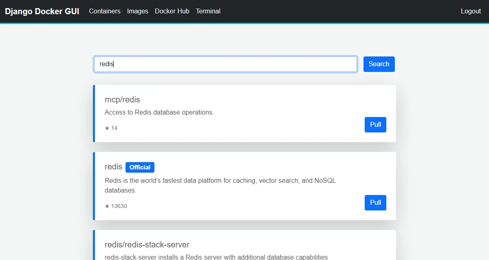

# Django Docker GUI

<p align="center">
  <a href="https://github.com/NatLee/django-docker-gui/actions/workflows/ci.yml"></a>
  
  
  <a href="./LICENSE"></a>
</p>

A small web UI for Docker on one machine. Log in and you get your containers and images in a
table, buttons to start, stop, restart and remove them, a Docker Hub search with a Pull button, and
a real terminal in the browser: a shell inside any running container (Console), the container's own
output (Attach), or a shell in the app's own container (Terminal). It is Django with Channels for
the WebSockets, RQ for the slow Docker calls, and xterm.js in the browser, all in two containers.

<p align="center">
  
</p>

> **For superusers only.** The app holds the host's Docker socket, which amounts to root on the host, so
> only superuser accounts can log in. Keep it on a trusted machine or network: see [Security](#security).

## How it works

<p align="center">
  <picture>
    <source media="(prefers-color-scheme: dark)" srcset="docs/images/architecture-dark.webp">
    
  </picture>
</p>

`docker compose up` starts two containers:

- **`d-docker-web`** runs two programs under supervisord: `manage.py runserver` (served by Daphne, so the
  same process answers the pages, the REST API and the WebSockets) and `manage.py rqworker default`, which
  does the Docker calls that can take a while. The host's `/var/run/docker.sock` is mounted into it.
- **`d-docker-redis`** holds the job queue and passes job events from the worker to every open page.

The pages are plain HTML and JavaScript. After you log in, the browser keeps a JWT (a signed login
token) in localStorage and sends it with every API call, and as a WebSocket subprotocol
`token.<base64>` when it opens a socket, because browsers can't add headers to WebSockets.

<p align="center">
  <picture>
    <source media="(prefers-color-scheme: dark)" srcset="docs/images/terminal-session-dark.webp">
    
  </picture>
</p>

**Console** starts a shell with `docker exec`: bash, or sh when the image has no bash (Alpine). The shell
writes its PID to a file first, so that closing the tab can end it again; Docker itself has no call for
that, and a shell left behind keeps running. **Attach** connects to the container's main process instead,
the way `docker attach` does: resizing is ignored there because that terminal is shared, and closing the
tab leaves the process alone. **Terminal** is the same kind of session with bash on a pseudo-terminal in
`d-docker-web` itself.

<p align="center">
  <picture>
    <source media="(prefers-color-scheme: dark)" srcset="docs/images/jobs-dark.webp">
    
  </picture>
</p>

Start, stop, restart and remove go through the job queue, so the page answers at once and shows
**Waiting** on that row; the Images page's Run and Remove are jobs too. When the worker is done, every
open Containers or Images page gets the result over `/ws/notifications/`: a toast and a fresh list, or a red toast with
Docker's reason when it failed (removing a running container, say). The Docker Hub page asks the Docker
daemon to search, the same search `docker search` runs, and streams `docker pull` progress into its
dialog.

## Quick start

You need Docker with Compose on Linux (or Docker Desktop / WSL), because the app uses the Docker socket.

```bash
git clone https://github.com/NatLee/django-docker-gui.git
cd django-docker-gui

# A secret key for logins: compose refuses to start without one.
cp .env.example .env
sed -i "s|^DJANGO_SECRET_KEY=.*|DJANGO_SECRET_KEY=$(openssl rand -base64 48)|" .env

docker compose up -d --build
bash dev-create-superuser.sh admin 'pick-a-password'
```

Then open http://localhost:8000 and log in. The first start applies the database migrations and
collects the static files, which takes a few seconds. The script creates a superuser, the only kind of
account that can log in. Without arguments it creates `admin` with the password `1234`, which is only
good for a quick try on your own machine.

## Using it

- **Containers**: every container on the host, running or not. Console and Attach open a terminal in a
  new tab; Start, Stop, Restart and Remove run as jobs (see above). The dot next to the title is green
  while the page is connected for job events.
- **Images**: every image with its size. Run starts a new container from it in the background (with a
  TTY); Remove deletes the image.
- **Docker Hub**: search, then Pull with an optional version (empty means `latest`).
- **Terminal**: a shell in `d-docker-web` itself, the container with the Docker socket.

<p align="center">
  
</p>

<p align="center">
  
</p>

In a terminal, Ctrl+C copies when you've selected text (Cmd+C on a Mac) and is sent to the shell
otherwise. The terminal follows the size of the window.

## Configuration

Everything is set in `.env` next to `docker-compose.yml` (see `.env.example`):

| Variable | Default | What it does |
|---|---|---|
| `DJANGO_SECRET_KEY` | none, required | Signs sessions and login tokens. Anyone who knows it can log in as anyone. |
| `DJANGO_DEBUG` | `0` | `1` shows Django's debug pages and serves edited static files without a restart. |
| `DJANGO_ALLOWED_HOSTS` | `*` | Host names the site answers to, comma-separated. WebSockets must come from a page on one of them. |

`docker-compose.yml` also sets `REDIS_URL` (`redis://redis:6379`). The app finds Docker the way the Docker
CLI does (`DOCKER_HOST` and friends, otherwise `/var/run/docker.sock`).

Good to know:

- **Port**: 8000 on all interfaces. To keep it to this machine, change the mapping in
  `docker-compose.yml` to `"127.0.0.1:8000:8000"`.
- **Logs**: `docker logs d-docker-web` shows the web server, the WebSocket consumers and the worker.
- **Data**: `./src` is mounted into the container (handy for hot reload), so the SQLite database with the
  users ends up in `src/db.sqlite3`.
- **Admin pages** (superusers, like everything else): Django admin at `/api/__hidden_admin/`, the RQ queue at
  `/api/__django-rq/`, the API docs at `/api/__hidden_swagger` and `/api/__hidden_redoc`.
- **Logins** last 60 hours (refresh token: 1 day). Changing `DJANGO_SECRET_KEY` logs everyone out.

## Security

This is a tool for one person or a small trusted team on one machine.

- **Only superusers can use it, everywhere.** Anyone who can open a Console can open one in
  `d-docker-web`, which has the Docker socket, and from there do anything on the host. So there's no point
  in smaller roles: the login, every API call, every WebSocket, the admin pages and the RQ pages all let in
  active superusers and nobody else. That rule lives in one place, `src/backend/access.py`. Other accounts
  get "No active superuser account found…" at login, the same answer as a wrong password, and someone who
  loses superuser is sent back to the login page with the reason. Only make people superusers if you'd give
  them root on the host.
- **Several people on one machine?** Use [Dev Dock Manager](https://github.com/NatLee/dev-dock-manager)
  instead: it gives each person their own desktop container rather than the whole Docker daemon.
- **Don't put it on the internet as it is.** It serves plain HTTP with Django's development server. If you
  need it from elsewhere, put it behind a reverse proxy with HTTPS and set `DJANGO_ALLOWED_HOSTS`.
- What it does to stay out of trouble: no default secret key, debug off, a superuser's valid token on every
  API call and every WebSocket, no cross-site API access (no CORS), text from
  containers and Docker Hub is escaped before it reaches the page, and every script from a CDN is pinned to
  one version and checked against its hash.

## Upgrading from an older checkout

- Create `.env` with a `DJANGO_SECRET_KEY` as in the quick start. Old login tokens stop working, so
  everyone logs in again.
- Only superusers can log in now. Make the people who should keep access superusers in the Django admin
  (`/api/__hidden_admin/`), or with `python manage.py createsuperuser` in `d-docker-web`.
- Google sign-in is gone. Delete the left-over `src/custom_auth/` folder (only generated files are in it).
  An older database keeps an empty `social_account` table, which does no harm; to drop it:
  `docker exec d-docker-web python manage.py shell -c "from django.db import connection; connection.cursor().execute('DROP TABLE IF EXISTS social_account')"`
- Logs no longer go to `src/logs/`; use `docker logs d-docker-web`.

## Development

```bash
# Unit tests, in the same image the app runs in
docker build -t django-docker-gui .
docker run --rm -e DJANGO_SECRET_KEY=dev-only-secret-of-at-least-32-bytes django-docker-gui \
  sh -c "python manage.py collectstatic --noinput -v 0 && python manage.py test"

# With the stack running: tests against the real Docker daemon and Redis
# (they create and remove their own containers, django-docker-gui-live-*)
docker exec -e LIVE_TESTS=1 d-docker-web python manage.py test xterm.tests.test_live
```

- `bash dev-bash.sh`: a shell in `d-docker-web`.
- `bash dev-supervisorctl.sh`: restart or stop the web server or the worker.
- Set `DJANGO_DEBUG=1` in `.env` while you work on the JavaScript or CSS in `src/static/`; with debug off
  the files are collected once at start.
- CI runs the unit tests, then starts the stack with `docker compose up`, runs the live tests inside it,
  and goes through login, the API and a console session over a real WebSocket.
- The diagrams are HTML in `docs/images/src/`; the comment at the top of each file says how to render it.

Where things are: `src/xterm/` has the pages, the API (`views.py`), the jobs (`task.py`), the WebSocket
consumers (`consumers.py`), their token check (`ws_auth.py`) and the terminal sessions (`terminal.py`).
Who may use the app is `src/backend/access.py`, for every part of it. `src/static/js/` has the page scripts; `terminal-session.js` is the one
terminal all three terminal pages use.

## Related

[Dev Dock Manager](https://github.com/NatLee/dev-dock-manager) grew out of this project: the same Django
apps and WebSocket terminal, turned into a dashboard that hands out full Linux desktops (one
[dev-dock](https://github.com/NatLee/dev-dock) container per person) with noVNC and SSH. Django Docker GUI
itself started as a refactor of [MahmoudAlyy/docker-django-ui](https://github.com/MahmoudAlyy/docker-django-ui).

## License

[MIT](./LICENSE)
